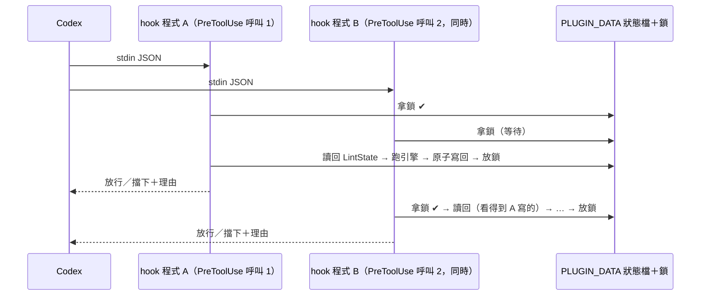

# 假說：Codex adapter 每個事件起一支新程式、平行 hook 共用一份狀態檔，lint-mod-state 的規則仍然守住

- **使用者要拿它做什麼**：決定 Codex 版 lint 能不能照「外部程式＋`PLUGIN_DATA` 狀態檔＋鎖」去做（`docs/adr/0001-codex-lint-bundle.md`）。如果不能，就改成常駐的 MCP server，這是計畫的備案。
- **理想**：Codex 上每件該提醒模型的事都恰好提醒一次，不該提醒的一次都不提醒；擋一次的放行只給模型看過訊息之後的同一個動作；一輪最多被留住 4 次；hook 自己出事時一律放行，不擋使用者，也不讓 lint 從此停擺。任何事件順序、任何平行交錯下都一樣——和 `lint-mod-state` 在 Claude Code 上證明的同一個理想。
- **已證明**（往上推）：**程式版**的鎖（`LockMode = "code"`）守住 C1、C2、C3、C5、C6——被殺 1 次 7,618 個狀態、被殺 2 次 55,355、拿鎖的程式卡住 1 次 59,601、卡住加被殺 2 次 429,917；C4 在每支 hook 都有回答時守住（166）。拿掉回答前和寫回前的鎖確認，卡住時 C1 被打破（3,172）。以下是設計期的結果，仍然成立：設計版（鎖只在拿鎖的程式已經死掉時才回收；先回答 Codex、再寫回狀態；hook 放棄時一律放行）守住 C1、C2、C3、C5、C6。範圍是一輪 3 個呼叫（其中 2 個平行、同一個動作）、Stop、使用者下一則訊息，以及最多 2 支 hook 程式在任一步被殺，共 41,034 個狀態。**C4（R11）只在每支 `PreToolUse` 都回答了 Codex 時守住**（`answering`，166 個狀態）。只要有一支在回答前斷掉，Codex 就會照常放行，3 步就打破 C4（P1）。R1–R21 在「每支 hook 都在鎖內跑完」時，靠 refinement 論證繼承（Q1），這部分沒有用 TLC 跑。
- **最好可能**（往下壓）：「C4 在 hook 有回答時守住」。hook 斷掉時，放不放行是 Codex 決定的（PoC Q10），adapter 管不到。要讓 hook 斷掉時也擋住，唯一的辦法是讓它回答 deny，但這直接違反 C5。所以任何 adapter 設計都超不過這一點。這部分是論證，只有自己讀過，沒有交給第二人檢查。
- **差距**：在「hook 有回答」的條件下，兩邊**相遇**（範圍內）。理想和最好可能之間差的那一段，就是 P1 那條路，Claude Code 也有（`lint-mod-state` 已接受「hook 逾時被跳過」）。這段差距修不掉，只能讓它更少發生。Codex 比 Claude Code 多出三個會走到這條路的原因：Node 找不到、每次都要啟動一支新程式、等鎖時放棄。可以做的事：
  - 等鎖的時間要遠短於 hook 的 `timeout`。
  - 計畫的成功條件 7：找不到 Node 時要說出來。
  - 每次呼叫要快：打包版約 310 ms。
- **主張與量詞**：在所有事件順序、所有平行 hook 程式的交錯、任何一支 hook 程式在任何一步被終止的情況下，(1) R1–R21 與 C1–C6 守住；(2) **等價**（使用者 2026-11-18：「目前 claude code 的所有 lint 機制都可以在 codex 重現（除了 ux）」）——同一串事件交給 Claude Code adapter 和 Codex adapter，模型收到的擋下、修正要求、提醒內容相同，最晚在同一步收到；卡片不比
- **規則確認**：已確認（使用者 2026-11-18：R1–R21 沿用、C1–C6、等價；讀法 D1 選 A、D2 選寧可重送）
- **涵蓋的對象**：Codex adapter 對每個 hook 事件的處理順序：拿鎖 → 讀回 `LintState` → 跑引擎方法 → 回答 Codex → 原子寫回 → 放鎖，以及引擎把工具呼叫和壓縮拆成前後兩半。引擎本體的狀態邏輯沿用 `lint-mod-state` 已證明的模型。
  - 程式：`plugins/baransu/hooks/adapters/codex/{main,store}.ts`；`engine.ts` 的 `callBefore`／`callAfter`、`compactBefore`／`compactAfter`、`wake`。
  - **鎖照程式建模**（`LockMode = "code"`，2026-11-18 `--maintain`）：hard link 一步建鎖；回收分三步——拿回收鎖、再確認舊鎖過期才刪、放回收鎖；回收鎖的主人死掉時由下一個等的人清掉；拿鎖期間每 10 秒心跳，所以只有死掉或卡住（`Stall`）的程式的鎖會過期；回答 Codex 前和寫回前各確認一次鎖還是自己的（`WriteGuard`）。設計版（`LockMode = "pid"`）的 run 保留，當作對照。
  - **沒有建模、靠論證繼承的**：回覆的計數（依序讀 transcript，`turn_context` 是新的一輪、`token_usage_record` 是一次回覆結束）、`after:*`（每支 hook 在鎖內呼叫引擎的 `wake()`）、使用者送出訊息、session 開始、subagent 開始與結束、壓縮前後。它們都是在鎖內跑完的一個引擎方法，Q1 的論證同樣適用；壓縮的前後兩半和工具呼叫的前後兩半是同一種形狀（拿走的東西存成紀錄，交給後一半或還回去）。
- **描述的版本**：8.49.0 工作樹（a741eba5 之後，還沒 commit）：store.ts `dcbd73bf335f…`、main.ts `acedaf13e727…`、engine.ts `6990010f069c…`。
- **定稿雜湊**：CodexHooks.tla `052ce55fe05f…`、CodexRules.tla `0be43ae10521…`、check.py `fa8509f2f1f8…`
- **重跑**：`python .claude/verify/run.py quick codex-lint-state/state`（跑完整 19 個 run，約 40 秒，指紋與判定見 `check.toml`）；完整（同一組 run 直接看每一行）：`cd model && python check.py`（19 個 run，約 45 秒）；只跑程式版：`python check.py code code-stall code-stall-noguard`（約 6 秒）

## 問題帳

| # | 問題 | 推動哪一邊 | 最便宜的證據 | 結清方式 | 結果 |
|---|---|---|---|---|---|
| Q1 | 每支 hook 程式在鎖內把整段「讀回→引擎→寫回」做完時，Codex 的執行是不是 `lint-mod-state` 模型裡某一種順序（每個事件仍是一個不可分的動作）——是的話 R1–R21 直接繼承 | 翻譯 | 論證（refinement）＋小型 TLA+ | 證明（論證）＋範圍內（TLC） | 有條件成立。在鎖內跑完的事件是一個不可分的動作，順序就是拿鎖的順序；每次重新讀回等於 `lint-mod-state` 已涵蓋的「重新載入」（讀法 D2，使用者已選 A）。TLC 只證實鎖本身（C1）。論證只有自己讀過。**例外**：hook 斷掉時，Codex 會照常放行（P1），這種事件不是模型裡的任何一步 |
| Q2 | 拿鎖的程式被 Codex 逾時殺掉、或鎖檔殘留時，回收鎖會不會造成兩支程式同時寫（蓋掉對方） | 已證明 | TLA+ | 範圍內（**對程式**，2026-11-18 `--maintain`） | 設計版：只回收已經死掉的程式留下的鎖，C1、C6 守住；`timeout-break` 打破 C1、`no-reclaim` 打破 C6。程式版（`code`）：三步回收守住 C1、C6。對回程式時找到一個實際的洞：原本「鎖存在超過 150 秒一律過期」等於 `timeout-break`——Codex 逾時殺的是外層 shell，底下的 Node 可能還活著（前提表）。改成心跳加上回答前、寫回前確認鎖，模型證實守住；只拿掉確認時打破 C1（`code-stall-noguard`） |
| Q3 | 程式在「寫回」和「輸出給 Codex」之間被殺掉時，欠的東西是遺失還是重複；改檔前放行後沒有改檔後時，拿走的欠帳與快照怎麼收回 | 已證明 | TLA+ | 範圍內 | 先回答、再寫回：最多重複一次，不會遺失（C2 守住，C2Strict 被打破，證實這個放寬是緊的）。先寫回、再回答會打破 C3（`write-first-c3`）。沒有 PostToolUse 時，留下的欠帳在 Stop 或使用者下一則訊息時收回，C3 守住 |
| Q4 | 最好可能 | 最好可能 | 論證 | 證明（論證） | 「C4 在 hook 有回答時守住」，見開頭。只有自己讀過 |
| Q6 | 等價：計畫裡 11 種 Claude Code 機制，每一種在 Codex 上的對應方式，模型看到的結果和時間點是否相同（只差卡片） | 已證明 | 每種機制在 Codex 上實跑一個場景；引擎新舊比對 | 範圍內（每種一個場景） | 獨立推導找到 P1，是兩邊共有的邊界。Codex 實跑（`.claude/prove-it/records/2026-11-18-codex-lint-pilot.md`）：改檔前後、刪除、`check`、Stop、remind、`$skill`、讀 `SKILL.md`、resume 後的 `post:file`、自動壓縮後的 `post:compact`、subagent 結束後，模型都在下一次動作收到對應的規則代號；英文段落被要求重說只在模擬裡走過。找到兩處 Codex 做不到一樣的：壓縮摘要是加密的，`post:compact` 改讀壓縮後保留的訊息；`post:file`、`after:*` 要等下一次 hook 才看得到，但模型收到的時間點相同（兩邊都排隊等下一步）。沒有在兩邊用同一個場景逐字比對模型收到的文字，所以是範圍內、每種一個場景 |
| Q5 | 範圍：一輪 3 個呼叫、最多 1 到 2 支程式被殺，夠不夠抓到這幾類錯 | 範圍 | 每個植入的 bug 都在這個範圍被抓到 | 範圍內 | 夠：6 種植入的錯（沒有鎖、等太久就回收、不回收、先寫回、放棄時擋下、C2 不放寬）都在 33 到 943 個狀態內被抓到；擴大到被殺 2 次結論不變 |

## 這部分在做什麼

## 裁判：規則

沿用（`lint-mod-state` 已確認的規則，換成 Codex 的事件）：R1–R21 全部，意思不變。下面是 Codex 部署才出現、要另外寫成規則的：

| # | 種類 | 規則（白話） | 出處 | 結果 |
|---|---|---|---|---|
| C1 | 不能發生 | 兩支 hook 程式都寫了狀態，其中一支寫的被另一支蓋掉（之後讀回的人看不到它） | 計畫成功條件 5 | 設計版守住；沒有鎖、等太久就回收時被打破 |
| C2 | 不能發生 | 同一件欠的事（一個「重新」、一行排隊的話、一次交代要求）送給模型兩次——唯一的例外：送出的那支程式在寫回前被殺掉，這時最多再送一次（讀法 D2：寧可重送）。**延伸（2026-11-18 `--maintain`，使用者確認「可以，照這樣算」）**：寫回前卡住、鎖被收回的程式，算成被殺掉 | R2、R21 的 Codex 版；計畫成功條件 5；使用者 2026-11-18 | 守住；這個例外是緊的（被殺時確實會重複一次） |
| C3 | 終究會發生 | 改檔前被放行、卻一直沒有改檔後的呼叫（被取消、被別的 hook 擋下、程式被殺），它拿走的欠帳最晚在使用者下一則訊息前送到模型；它留下的前快照最晚在這一輪結束時清掉 | 計畫成功條件 10 | 守住；先寫回、再回答時被打破 |
| C4 | 不能發生 | 擋一次就放行的動作（刪除預覽、`check`），被同一次回覆裡的另一份相同指令放行——模型還沒看到擋下的理由 | R11 的 Codex 版；判定看 Codex 實際執行了什麼（獨立推導 2026-11-18 後修正） | **被打破**（P1）：hook 在回答前斷掉時，Codex 照常放行；hook 都有回答時守住 |
| C5 | 不能發生 | hook 程式自己出錯、逾時、拿不到鎖時，把使用者的動作擋下 | 引擎的「mod 失敗不擋使用者」（CLAUDE.md 的 lint mod 不變式） | 守住；放棄時回答 deny 的植入 bug 會打破它 |
| C6 | 終究會發生 | 拿鎖的程式死掉留下的鎖，在有限時間內被收回，之後的 hook 恢復檢查（lint 不會從此靜默失效） | 理想 | 守住（寫成「不會因為死掉的人拿著鎖而放棄」）；完全不回收時被打破 |

上層規範：無

## 數學本質

兩種混在一起：

- **順序**（H1、H3）：多支 hook 程式交錯，任何一支都可能在任一步被終止，順序由 Codex 決定。用 TLA+／TLC 列舉範圍內的所有順序。Q1 的繼承靠 refinement 論證，由一個小型模型撐住。
- **等價**：兩個 adapter 在同一串事件上，模型可觀察的輸出要相同。判定方式是把兩邊的觀察值逐項比對（擋下、理由、提醒、送達的步）。Q6 的每一種機制各是一個比對單位。

## 前提

| 前提 | 以為 | 出處 | 怎麼確定 | 結果 |
|---|---|---|---|---|
| 同一次回覆裡的平行工具呼叫，Codex 會同時跑它們的 hook | 可能 | 無 | 假設（設計期）；試點實測 | 模型讓兩支同時跑；不同時跑也安全，鎖的結論不變 |
| hook 斷掉（逾時、當掉）時，Codex 照常執行工具 | 是 | PoC Q10：逾時的 handler 2,012 ms、2,005 ms，工具照常回傳 | 實測 | P1 的第 3 步 |
| hook 逾時時 Codex 會終止那支程式（不只是放行） | 不一定 | PoC Q10 只量到「放行」與 2 秒延遲；Codex 原始碼 `command_runner.rs` 對 shell 那支程式設 `kill_on_drop`，hook 指令是在模型用的 shell 裡跑的，Node 是它底下的子程式，Windows 上不會跟著被殺 | 讀出 | 模型允許程式在任一步消失，也允許活著卻卡住（`Stall`）；後者是心跳和鎖確認要處理的情況 |
| 回收鎖的人在「確認舊鎖過期」和「刪掉它」之間不會卡住超過 10 秒 | 是 | store.ts `#reap`：兩個檔案操作之間沒有別的工作 | 假設 | 模型沒有讓回收的人卡住；不成立時，回收鎖可能被當成過期刪掉，兩個回收的人可能都刪鎖 |
| 放行的 PreToolUse 之後一定有 PostToolUse | 否 | 被取消、被別的 hook 擋、工具被沙箱拒絕 | 假設 | 模型允許沒有 Post |
| Windows 上 `fs.renameSync` 取代既有檔案是原子的（讀的人看到舊的或新的，不會是一半） | 是 | NTFS `MoveFileEx(MOVEFILE_REPLACE_EXISTING)` | 假設 | 模型把寫回當成一步 |
| adapter 分得出「同一次回覆」：依序讀 `transcript_path`，每筆 `token_usage_record` 是一次回覆結束，`turn_context` 是新的一輪 | 是 | 試點：真的 rollout 依序是 `turn_context` → 模型說話 → 工具呼叫 → `token_usage_record`；同一次回覆內重送的刪除仍被擋下，下一次回覆才放行（Codex 實跑，`.claude/prove-it/records/2026-11-18-codex-lint-pilot.md`） | 實測（單一呼叫）；平行呼叫是否都在 `token_usage_record` 之前觸發 hook，還是假設 | C4 依賴它 |
| `PreToolUse` 的 `additionalContext` 會送到模型（欠帳可以在改檔前就交付） | 可能 | 官方文件；PoC 只量了 PostToolUse、SessionStart、UserPromptSubmit | 假設；Q3 的修法可能依賴它 | |

## 讀法

| 問題 | 讀法 A | 讀法 B | 結論 | 交件 |
|---|---|---|---|---|
| D1：Codex 上「同一次回覆」指什麼 | 模型的同一次取樣（同一個 response） | 同一個 `turn_id` | 使用者選 A（2026-11-18） | 主交件 |
| D2：被殺的程式已經寫回、卻沒輸出給 Codex，欠的事算什麼 | 寧可重送（先輸出、再寫回） | 寧可遺失（先寫回、再輸出） | 使用者選 A：寧可重送（2026-11-18） | 主交件 |

裁判的校對：設計期還沒有程式，所以拿 PoC 實測過的 Codex 行為當已知事實來對照。hook 斷掉時照常放行（Q10）→ 模型的 `Eff`；同一輪內重送相同的指令，`turn_id` 相同、`tool_use_id` 不同（Q3）→ 模型裡不同的呼叫；hook 的狀態檔寫得進 `PLUGIN_DATA` 而且跨次執行都保留（Q9）→ 模型的 `file`。三項都對得上。

## 界與證據

| 界 | 值 | 依據 | 是緊的嗎 | 證明／範圍內 | 對哪一類成立、模型外有什麼 |
|---|---|---|---|---|---|
| 已證明 | 設計版守住 C1、C2、C3、C5、C6；C4 在 hook 都有回答時守住 | TLC：`design` 6,645 個狀態、`design-2-kills` 41,034、`answering` 166 | 是：每條都有一個植入的錯在範圍內打破它；C2 的放寬由 `design-c2-tight` 證明是需要的 | 範圍內 | 模型外：引擎本身的邏輯（交給 `lint-mod-state`）、檢查的內容、hook 的開銷、多過 3 個呼叫的回合 |
| 最好可能 | C4 只能做到「hook 有回答時守住」 | 論證：hook 斷掉時放不放行由 Codex 決定，回答 deny 又違反 C5。只有自己讀過 | 是：`answering-plus-kill` 只要 3 步就打破 | 證明（論證） | 對任何讓 Codex 在 hook 失敗時放行的宿主都成立，Claude Code 也一樣 |
| 原本的假設 | 「鎖＋每次重新讀回，R1–R21 照樣守住」 | 錯，反例是 P1；在「hook 有回答」的條件下才對 | — | — | — |

模型裡沒有出處的條件：無。每個動作都對到計畫的設計，或 PoC 量到的 Codex 行為。

## 檢查會說不

| 怎麼弄壞或拿掉 | 結果 |
|---|---|
| 不加鎖（`no-lock`） | C1 被打破（287 個狀態） |
| 等太久就回收活著的人拿著的鎖（`timeout-break`） | C1 被打破（943） |
| 死掉的人拿著的鎖不回收（`no-reclaim`） | C6 被打破（61） |
| 先寫回、再回答 Codex（`write-first-c3`） | C3 被打破（585）：欠的東西被記成已送出，卻從沒送到 |
| hook 放棄時回答 deny（`giveup-deny`） | C5 被打破（33） |
| C2 不准被殺時重送（`design-c2-tight`） | C2Strict 被打破（324）：這個放寬是必要的 |
| 程式版拿掉回答前、寫回前的鎖確認，拿鎖的人卡住一次（`code-stall-noguard`） | C1 被打破（3,172）：卡住的人醒來後把舊的狀態寫回去 |
| 程式版只在寫回前確認、回答前不確認（`--maintain` 途中的版本，反例在 `traces/code-stall-writeguard-only.txt`） | C2 被打破（1,893）：卡住的人醒來後又把同一件事送一次，沒被算成例外 |

## 第二份獨立推導

Codex Sol 6.2 只拿到主張、規則、計畫檔、引擎與 adapter 的原始碼，以及 PoC 的紀錄，看不到這個模型。它的結果檔在定稿之後才打開。打開前比對過工作目錄：`git status` 和派它出去時相同，只多了這個資料夾。

它在第一項（R1–R21）就找到 R11 的反例，之後照指示停下。這個反例揭露的是**我的裁判翻譯錯了**：C4 原本只看「引擎決定放行」，沒看「Codex 實際執行了」。修正後，模型在 3 步內重現它的路徑（P1）。這次的修正只改裁判、沒有改設計，所以沒有再送去複查。C1 到 C6 和等價的其餘各列，它沒有攻擊。

## 範圍

一輪裡有：兩個平行、內容相同、需要先擋一次的動作（第 1 次回覆）；第 2 次回覆再送一次同樣的動作；Stop；使用者下一則訊息。從上一輪欠下 1 件事，Stop 再排 1 件。最多 1 到 2 支 hook 程式在任一步被殺。範圍夠用的理由：每個植入的錯都在這個範圍裡被抓到，被殺次數從 1 加到 2，結論不變。

標為假設的前提：見前提表。沒有建模的部分：引擎本身（交給 `lint-mod-state`）、subagent 的 hook（和主迴圈用同一套機制）、壓縮前後、檢查的內容。

## 路徑

- [P1](paths/P1.md)：hook 在回答前就斷掉，需要先預覽的刪除被直接執行（C4／R11）。

## 模型對照

| 模型裡的名字 | 程式或文件 |
|---|---|
| `Acquire`／`GiveUp`／`Release` | store.ts `SessionFile.lock`（`#create`：hard link）、`lock` 的放棄、`unlock`（只刪自己的） |
| `ReapTake`／`ReapDo`／`ReapDrop`／`ReapBreak` | store.ts `#reap`：`.reap` 回收鎖、再確認 `#stale` 才刪、只刪自己的回收鎖；死掉的回收者留下的回收鎖由 `#stale(reap, MAX_REAP_MS)` 清掉 |
| `StaleL`／`Stall` | store.ts `#stale`：pid 已死，或鎖檔超過 150 秒沒被碰過；拿鎖期間每 10 秒心跳（`BEAT_MS`），所以活著的程式只有卡住時才會過期 |
| `Skip` | main.ts：`file.owns()` 為 false 時回答 `{}`、不寫回 |
| `Read` | 計畫：讀回 `LintState`，跑一個引擎方法（`engine.ts` 的 `toolCall` 拆成兩半之後的 before 或 after、`stopping`、`promptSubmit`） |
| `Out` | 回答 Codex：`permissionDecision`、`additionalContext`、Stop 的 `decision`（PoC 第一、二輪） |
| `Write` | 計畫：把狀態原子替換回 `PLUGIN_DATA` |
| `Kill` | Codex 逾時、Node 當掉（PoC Q10） |
| `Eff` | Codex 把 hook 失敗當成放行（PoC Q10） |
| `file.pend` | 計畫：`toolCall` 的 before 一半存下、等 after 一半讀回的紀錄 |
| `file.held` | `timing.ts` 的 hold-once 紀錄 |

## 問題

- Q6 是範圍內：每種機制在 Codex 上一個場景，沒有在兩邊用同一個場景逐字比對模型收到的文字。
- C2 的延伸（卡住、鎖被收回的程式算成被殺）：使用者 2026-11-18 確認。
- 平行的 hook 同時跑：試點已量到（三支 PreToolUse 開始時間差 4 ms，鎖讓它們依序跑）。
- 最好可能的論證只有自己讀過，沒有交給第二人檢查。

## 維護紀錄

- **2026-11-18 `--maintain`（8.49.0 工作樹）**：把鎖照程式建模（`code`），新增 7 個 run；19 個 run 全部符合預期。對回程式時找到「鎖存在超過 150 秒一律過期」等於回收活著的人的鎖，改成心跳加上回答前、寫回前確認鎖（store.ts、main.ts），模型證實守住。C2 的例外延伸到卡住、鎖被收回的程式（使用者已確認）。Q2 對程式結清；Q6 由 Codex 實跑改成範圍內。
