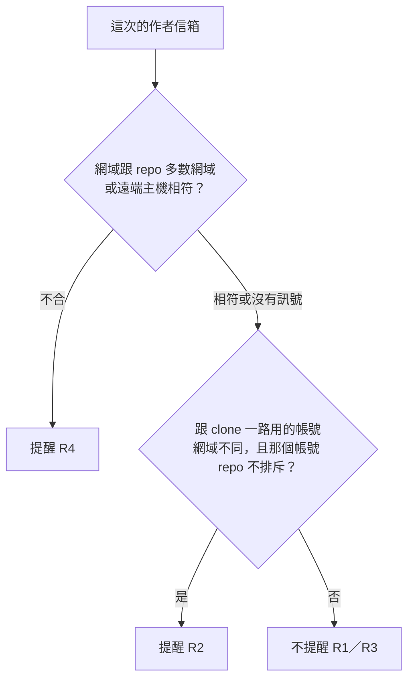

# 假說：git-facts 的帳號提醒，用對帳號的不被打擾、換錯帳號的那次一定被提醒

- **使用者要拿它做什麼**：決定 git-facts 的帳號判斷能不能放進多人／外包專案，不再把自己人卡住
- **理想**：用對帳號的人不被打擾；換錯帳號的那一次一定被提醒；任何情況都不擋
- **已證明**（往上推）：R1、R2、R4 對任意長度的歷史成立（Lean）；所有訊號組合下，除了已知盲點與兩類已接受的提醒，沒有別的誤報或漏報（TLC，每個組合都列舉過）
- **最好可能**（往下壓）：已知盲點無法消除——錯的帳號從 clone 第一天就在用、又跟 repo 自己的網域相符（或 repo 沒有多數網域）時，兩個訊號都和用對時一模一樣，任何只看這兩個訊號的判斷都分不出來
- **差距**：在這兩個訊號之內「相遇」（證明＋範圍內）；要更好只能加新訊號（例如使用者自己宣告「這個 repo 用哪個帳號」）
- **主張與量詞**：對每一種帳號、網域、歷史、遠端主機的組合
- **規則確認**：已確認（2026-11-19，第 6 種要抓、因此第 2 種也提醒）
- **涵蓋的對象**：`plugins/baransu/hooks/engine/moments.ts` :: `wrongAccount`、`commonDomain`、`hostOf`、`selfIdentity`、`gitFactsAtCommit`
- **描述的版本**：base `e79a9088` ＋ 8.50.0 未 commit 的修改（之後這些內容改過，就先重跑再相信）
- **定稿雜湊**（sha256 前 16 碼）：moments.ts `04ae81cc196065ac`；GitAccount.tla `e36b3edacbc9f4e6`；GitAccount.cfg `8e5dd5a27d0f411a`；GitAccount.lean `65ceec74cdfd2308`
- **重跑**：快速 `python .claude/verify/run.py quick git-account/account`（Lean 加 TLC 一起跑，約 4 秒，第一次冷啟動約 35 秒）；完整：單看 Lean `cd model && lean GitAccount.lean`（約 1 秒；`model/lean-toolchain` 鎖在 v4.35.0，與 lean-work 同版，不用 Mathlib）；單看 TLC `cd model && tlc -workers 1 -deadlock -config GitAccount.cfg GitAccount.tla`（約 3 秒），再跑 `variants/` 兩個，各應被打破一條

## 問題帳

| # | 問題 | 推動哪一邊 | 最便宜的證據 | 結清方式 | 結果 |
|---|---|---|---|---|---|
| Q1 | 所有組合下，除了已知的，還有沒有別的誤報／漏報 | 已證明 | TLC 列舉 3 網域 × 每網域 0–2 個地址 × 主機 × reflog × 作者 × 該用的帳號 | 範圍內 | 找到 P1，歸類後無其他 |
| Q2 | R1／R2／R4 對任意長度的歷史成立嗎 | 已證明 | Lean | 證明 | 成立 |
| Q3 | 「多數網域」在任何大小的歷史裡都唯一嗎 | 翻譯 | Lean `majority_unique` | 證明 | 唯一 |
| Q4 | 已知盲點能不能用現有訊號消除 | 最好可能 | 論證：盲點情況下兩個訊號與用對時相同 | 證明 | 不能 |

還開著的列與理由：無

## 這部分在做什麼

## 裁判：規則

| # | 種類 | 規則（白話） | 出處 | 結果 |
|---|---|---|---|---|
| R1 | 不能發生 | 一路用同一個帳號、網域跟 repo 相符，卻被提醒 | 使用者 2026-11-19 | 守住（Lean `r1_quiet`） |
| R2 | 不能發生 | 換成另一個網域的帳號，卻沒提醒 | 使用者 2026-11-19 | 守住（Lean `r2_catch`）；已知盲點除外 |
| R3 | 不能發生 | push 夾帶同網域同事的 commit 被提醒 | 使用者 2026-11-19 | 守住（同 R1：只比網域） |
| R4 | 終究會發生 | 作者網域跟 repo 多數、遠端主機都不合 → 提醒（含外包第 2、3 種、第 6 種） | 使用者 2026-11-19 | 守住（Lean `r4_foreign`） |
| R5 | 不能發生 | 被擋 | 使用者 2026-11-19 | 守住（preset 等級 `warn`；不在模型裡，讀出 git.toml） |

上層規範：無

## 數學本質

有限情境的判斷函式，加上「對任意長度歷史」的性質：TLC 當列舉器跑遍所有訊號組合，Lean 證明對任何大小都成立的部分。

## 前提

| 前提 | 以為 | 出處 | 怎麼確定 | 結果 |
|---|---|---|---|---|
| reflog 記下每次本機操作的身分 | 是 | `git log -g --format=%ge` | 實測（這個 repo 與暫存 repo） | 是；clone 那一筆是當時的全域設定 |
| 多數網域以最近 500 個 commit 的不同地址計 | 是 | moments.ts::commonDomain | 讀出 | 是 |
| 遠端主機比對用後綴（git.abc.def 配 @abc.def） | 是 | moments.ts::wrongAccount | 讀出；模型簡化成相等 | 模型外 |
| warn 在 Codex 是工具跑完後才交給模型 | 是 | adapters/codex/main.ts PreToolUse | 實測 | 是 |

裁判的校對：暫存 repo 實跑 6 個情境（自己、私人信箱、同網域同事、推同事、推私人、第一天就用錯），結果與模型一致。

## 界與證據

| 界 | 值 | 依據 | 是緊的嗎 | 證明／範圍內 | 對哪一類成立、模型外有什麼 |
|---|---|---|---|---|---|
| 已證明 | R1、R2、R4 | Lean，只有標準公理；TLC 列舉無其他違反 | 是：盲點的組合一步都改不了 | Lean 證明；TLC 範圍內（每網域 0–2 個地址） | 模型外：主機後綴、多於 3 個網域、reflog 只看最近 20 筆 |
| 最好可能 | 盲點不可消除 | Q4 論證 | — | 證明（只就這兩個訊號而言） | 加新訊號就不適用 |

模型裡沒有出處的條件：無

## 檢查會說不

| 怎麼弄壞或拿掉 | 結果 |
|---|---|
| 拿掉「跟 clone 一路的帳號比」（`variants/NoSelf.tla`） | R2_Catch 被打破 |
| 永遠提醒（`variants/AlwaysWarn.tla`） | R1_Quiet 被打破 |

## 發現

- **P1**：clone 時用了錯的帳號（例如全域設定是公司信箱），之後改回對的帳號，會一直被提醒「你在這個 clone 之前用 <公司信箱>」。這是 R2 的設計行為（分不出「改正」和「換錯」），但會**持續**到 reflog 裡新帳號的次數超過舊的為止，可能要上百次操作。已修（使用者 2026-11-19 選「看最近幾筆」）：`selfIdentity` 改看 reflog 最近 20 筆裡最多的身分；改正後約 10 次操作就不再提醒，偶爾一次用錯仍只佔 1 筆、下一次照樣被抓。判斷函式沒變，TLA+／Lean 的結論不受影響（`self` 在模型裡本來就是任意值）。

## 第二份獨立推導

應使用者「輕鬆跑一下」的要求沒有派出。
