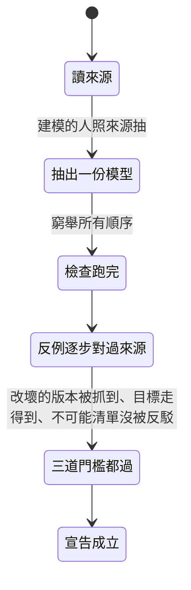
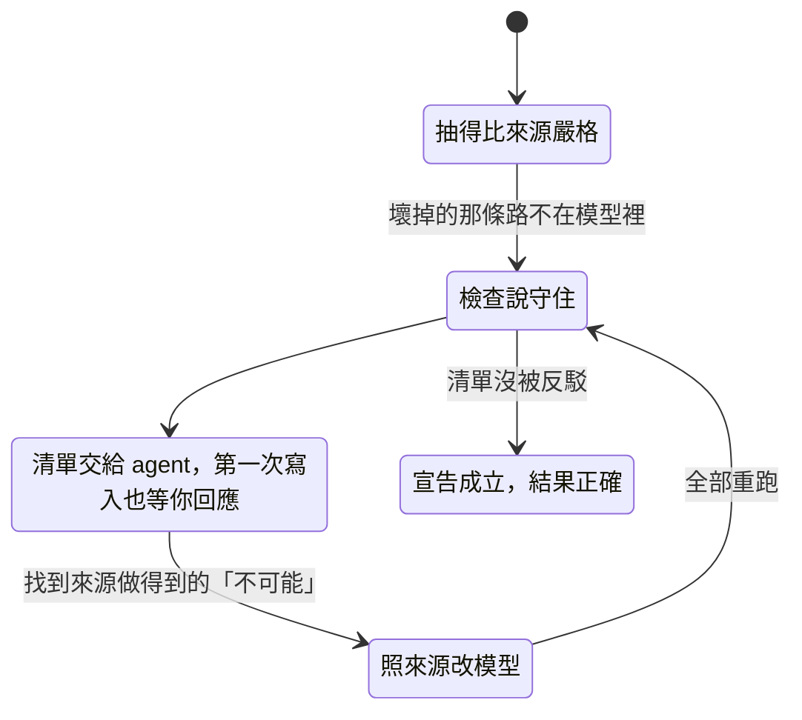
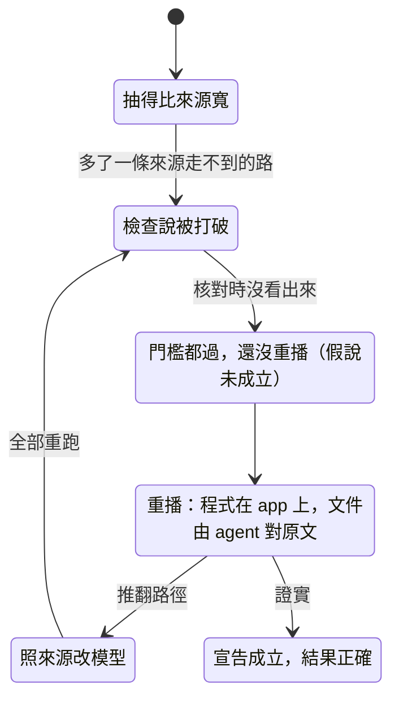

# 假說：抽錯的模型會不會一路通過

> 狀態以這行指令為準，不以本頁為準：`python3 plugins/baransu/skills/hypothesis/scripts/hypothesis-status.py --area model-fidelity`

## 一句話

`/hypothesis` 宣告一份假說成立時，它說的「守住」或「被打破」，必須跟來源的實際情況一致。這份假說檢查的是 skill 自己的文件（8.27.0），不是任何專案的程式：如果建模的人抽錯了，照文件寫的流程走，假說還會不會照樣成立？

## 規則

| # | 種類 | 白話 | 依據 | 結論 |
|---|---|---|---|---|
| R1 | 安全 | 成立的假說說「守住」時，來源真的守得住 | `SKILL.md:17-18` | 守住，前提是反駁的 agent 獨立（A2），或使用者熟這段來源 |
| R2 | 安全 | 成立的假說說「被打破」時，來源真的有問題 | `SKILL.md:77`、`formal.md:67` | 守住 |
| R3 | 安全 | 重播之後，成立的假說說「被打破」時，來源真的有問題 | `SKILL.md:77` | 守住 |
| G1 | 目標 | 來源真的有問題時，假說能找到它並成立 | `SKILL.md:17` | 做得到 |
| G2 | 目標 | 來源沒問題時，假說能成立為「守住」 | `SKILL.md:17` | 做得到 |

## 找到的問題

目前沒有：照 8.27.0 的文件，三條規則都守住。下面這些是這份假說一路找到、已經在 skill 裡修掉的問題，修正前的寫法留在 `variants/`，當作「看過它失敗」的證據。

| 版本 | 問題 | 怎麼修的 | 證據 |
|---|---|---|---|
| 8.26.0 | 抽得比來源嚴格的模型說「守住」，把真的問題藏起來；兩道門檻都擋不住 | 第三道門檻：不可能清單交給沒看過模型的 agent 反駁 | `variants/V826-R1.cfg` |
| 8.27.0 草稿 | 抽得太寬的模型捏造出「被打破」，在重播推翻它之前，已經以成立假說的身分發布（原本的 P1） | 有規則被打破時，每條路徑記下重播結果之前判「假說未成立」 | `variants/R2-NoReplay.cfg` |
| 8.27.0 草稿 | 來源是文件時沒有重播，捏造的矛盾會一直留著（原本的 P2） | 文件的重播：沒看過模型的 agent 拿路徑引用的原文逐步核對 | `variants/R3-NoReplay.cfg` |
| 8.27.0 草稿 | 使用者那一半的反駁沒有時機：清單在建模後才有，第一次寫入唯一的暫停在建模前 | 第一次寫入多一個暫停點，等使用者回應清單 | 清單第 4、12 條 |

另外兩個壞掉的版本說明前提是必要的：只盲抽比對、不做清單（`variants/Blind2-R1.cfg`）；反駁者跟建模者有同樣的盲點，使用者又不熟這段來源（`variants/SharedChecker-R1.cfg`）。

## 圖

圖 1　正常流程：抽模型、檢查、核對反例、過三道門檻、成立

圖 2　加上「抽得比來源嚴格」：不可能清單交給沒看過模型的 agent 和你，被反駁就照來源改模型、全部重跑

圖 3　加上「抽得比來源寬」：有規則被打破時，先重播、再成立

目前沒有任何路徑，所以沒有編號的紅框。

## 範圍

- 一次執行、一條由模型檢查器判的規則、一段來源（會跑的程式或文件）；來源不是有問題就是沒有。
- 模型三種：跟來源一樣、比來源嚴格、比來源寬。程式對程式的比對有兩位建模者，各自可能是三種之一。
- 四種流程：8.27.0 照寫的、8.27.0 程式對程式、8.26.0、只盲抽。
- 前提：A1 投影比對看得出抽法不同；A2 獨立的反駁者找得到來源做得到的「不可能」；A3 重播可靠；A4 抽錯的模型可能過門檻；A5 嚴格的模型的清單裡，一定有一條來源做得到的事。全文見 `hypothesis.json` 的 `check.assumptions`。
- 不涵蓋：之後的維護（第三道門檻綁定來源雜湊，來源一改就要重新反駁）、重構比對那條規則本身的結論、以文件或程式當規則端的精化比對、模糊用語的多種讀法、人手改檔、`/draft` 骨架型的假說。
- 窮舉的結論只在這個範圍內成立。

## 怎麼檢查的

- **工具**：TLA+，TLC2 2.19。
- **指令**：`python .claude/hypothesis/model-fidelity/model/check.py <tla2tools.jar>`，19 項檢查，每項一個設定，單一 worker，最多 105 個狀態。
- **看過它失敗**：R1 由 8.26.0 的流程打破；R2 由「不重播就成立」打破；R3 由「不重播」打破（`variants/` 下各一）。
- **看過它成功**：G1、G2 都做得到；拿掉「通過門檻」就都走不到（`variants/G1-NoGates.cfg`、`variants/G2-NoGates.cfg`）。
- **看過它像程式**：不可能清單（9 個動作各一條、4 個變數各一條）交給全新的 agent，它們只拿到文件和清單，看不到模型。因為 8.27.0 的文件一路被這份假說和 /review 改，總共反駁了十一輪：

  | 輪 | 條數 | 被反駁 | 主要抓到什麼 |
  |---|---|---|---|
  | 1 | 11 | 8 | 「沒有影響」的維護跳過重新反駁（之後綁定來源雜湊）；「行為一樣」沒寫只在比過的範圍內；模型順序抽錯 |
  | 2 | 13 | 10 | 改了模型卻不重跑；公平性假設可以不引用來源；重播排在成立之後 |
  | 3 | 13 | 4 | 文件型來源沒有重播；程式對程式的順序 |
  | 4 | 13 | 5 | 清單給人看的位置寫在建模之前；條目寫得比模型絕對 |
  | 5 | 13 | 4 | 門檻沒過要在同一次執行修好；比對步驟的文字 |
  | 6–8 | 13 → 2 | 2 → 1 | 條目列舉不完整，收斂 |
  | 9（依整體 review 改文件後） | 13 | 2 | 「全部重跑」沒有包含重播，舊的重播結果會留著 |
  | 10–11 | 13 | 見 `hypothesis.json` | 最後一輪 |

  每一次被反駁，都照來源改模型、全部重跑，或者條目寫得比模型絕對時改寫條目、交回反駁者。紀錄綁定目前的模型與來源雜湊。

## 對應表

| 模型部分 | 種類 | 來源 |
|---|---|---|
| `Extract` | 動作 | `SKILL.md:46`、`formal.md:63`、`sources.md:37` |
| `Check` | 動作 | `SKILL.md:65` |
| `Trace` | 動作 | `SKILL.md:71`、`formal.md:67` |
| `Facts` | 動作 | `SKILL.md:69`、`formal.md:69-74` |
| `Compare` | 動作 | `sources.md:37-40`、dogfood `:59-63` |
| `Gates` | 動作 | `SKILL.md:67-68`、`:75`、`formal.md:64-65`、dogfood `:92` |
| `ReplayStep` | 動作 | `SKILL.md:77`、`formal.md:67`、dogfood `:93` |
| `Done` | 動作 | `SKILL.md:77` |
| `FixAll` | 動作 | `formal.md:67`、`:72`、dogfood `:63` |
| `fid` | 變數 | `formal.md:63`、dogfood `:53` |
| `verdict` | 變數 | `SKILL.md:65` |
| `pc` | 變數 | `SKILL.md:63-77` |
| `did` | 變數 | `formal.md:67` |
| `code` | 觀察用 | R1、R2、R3、G1、G2 |
| `Process`、`UserKnows`、`Checker`、`Replay`、`Kind` | 參數 | `SKILL.md:65-69`、`:54`、`:69`、`loop-pauses.md:12`、`formal.md:71`、`:74`、`SKILL.md:77`、`sources.md:35` |

dogfood = `sources/dogfood-2026-10-25.md`（`.claude/dogfood/` 那份紀錄的凍結副本，拿某個時間點的快照當證據，所以不追蹤原檔）。

## 沒有形式化的部分

| # | 哪裡 | 類別 | 內容 | 要等到 | 現在怎麼辦 |
|---|---|---|---|---|---|
| U1 | dogfood `:102`「通過的模型也要拿真實執行驗一次」 | 無法建模 | 拿真實執行對照模型抓不抓得到太嚴的錯，要看測試有沒有碰到那個邊界 | 專案能插入事件紀錄，並且有碰到邊界的測試 | none |
| U2 | dogfood `:101`「原子性要附證據」 | 無法建模 | 引用範圍裡有沒有兩個沒被鎖包住的共享寫入，要看實際程式 | 有一支能讀 `model_map` 引用範圍並找出共享寫入的腳本 | red/green test |
| U3 | 抽錯的具體樣子 | 無法建模 | 模型只分嚴格、寬、一樣三種；兩份一樣嚴格的被當成錯在同一處，這是最不利的假設 | 無 | none |

## 同步點

commit `c99d9cf` 上的 8.27.0 工作區，第 4 版，2026-10-25 發布；實際雜湊以 `hypothesis.json` 為準。涵蓋的檔案改過，本頁結論就失效，以指令輸出為準。
