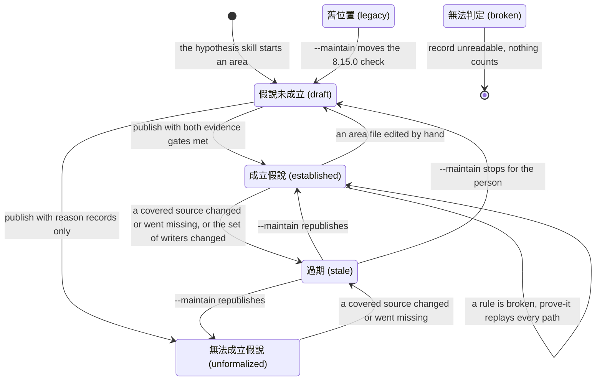

# hypothesis-states — the one picture of how a hypothesis moves

> Shared by every skill that reads or writes a hypothesis: `$baransu:hypothesis` (the only writer),
> and the readers `$baransu:review`, `$baransu:hunt`, `$baransu:prove-it`, `$baransu:health`, `$baransu:draft` and the green step of
> `tdd.md`. This file owns the transitions — what moves an area from one state to another and
> who makes the move. What each reader does in each state is `../hypothesis/references/reading.md`
> § State × reader; the state set and the order the script decides it in are in the same file
> § States. Cue for every user-facing line: use the plain names below.

The work follows an experiment: observation (`$baransu:hunt`, reading the source) → establishing the
hypothesis (`$baransu:hypothesis`) → proving it (`$baransu:prove-it`: 證實／推翻／無法到達). A hypothesis's own
states never claim proof; its success is 成立假說.

## Who moves each state

| From → to | Trigger | Who acts |
|---|---|---|
| — → 假說未成立 | a request, an H1–H8 row, a `$baransu:hunt` hand-off, a `$baransu:draft` sketch | `$baransu:hypothesis` |
| 舊位置 → 假說未成立 | the first `--maintain` run offers the move (`../hypothesis/references/maintain.md` § Migration) | `$baransu:hypothesis --maintain` |
| 假說未成立 → 成立假說 | publish, with every safety and liveness rule seen failing and every goal seen succeeding | `$baransu:hypothesis` |
| 假說未成立 → 無法成立假說 | publish, with every part ending in a reason record | `$baransu:hypothesis` |
| 成立假說 or 無法成立假說 → 過期 | a covered file's content hash moved, a file is gone, or a watch pattern's matches changed; computed at read time | nobody writes it: the status script sees it |
| 過期 → 成立假說 / 無法成立假說 | `--maintain` sorts every change and republishes | a reader that sees 過期 calls `$baransu:hypothesis --maintain` at once; the main session makes the call, never a review agent |
| 過期 → 假說未成立 | `--maintain` cannot sort a change without the person (a promise may have changed on purpose) | `$baransu:hypothesis --maintain` stops and asks |
| 成立假說 → 假說未成立 | an area file differs from what the last publish hashed | nobody writes it: the status script sees it |
| 成立假說, a rule 被打破 | right after publish, for a code source | `$baransu:hypothesis` hands the paths to `$baransu:prove-it`, which replays each on the real app |
| any → 無法判定 | `hypothesis.json` unreadable or of an unknown schema | nobody writes it: the status script sees it |

Readers never move a state themselves. They read it with `hypothesis-status.py`
(`../hypothesis/references/reading.md` § One command) and, for 過期, call the writer.
