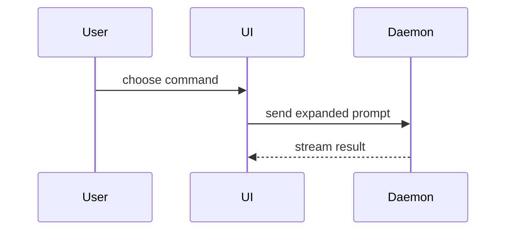

Help the user understand the current topic of conversation visually. Skip the preamble and keep prose brief. Pick the smallest view that makes the key point clear.

When the host offers a tool that draws a diagram or a chart inline in the conversation — even one only listed as deferred, which you load first — draw every picture with it — a flow, a state picture, a before and after, a chart, or what would otherwise be an HTML page. A Mermaid block is a picture only where the host renders it; where it would show as source, it is not a visual. The text forms below are for a host without such a tool, and for points whose shape is text anyway: pseudocode, a call tree, a file tree, a diff, a code block.

All user-facing prose is in Traditional Chinese; labels in a figure follow the code or the product they show.

## Outcome Contract

- **Outcome**: The user sees the current point in the smallest view that makes it clear, next to one or two lines of text.
- **Done when**: Each visual answers the question at hand with only the calls, files, props, states, and boundaries it needs.
- **Evidence**: The visual in the reply, and the path of any HTML file opened.
- **Output**: The reply; `.codex/show-me/*.html` when the point needs a page.
- **Automation**: ultracode=neutral, loop=not-drivable（the view answers the person's current question）

- Show logic or an algorithm as pseudocode:

```text
on(save)
  if content is unchanged
    return cached result
  write new content
  return fresh result
```

- Show runtime control flow as a call tree:

```text
submitForm
  createSession
    persistPrompt
    launchAgent
  navigateToSession
```

- Show UI structure as a component tree, including state and module boundaries that matter:

```tsx
<SessionPage> (apps/example/src/routes/session.tsx)
  useSessionEvents()
  <SessionToolbar>
    <RunSkillButton> (packages/ui)
```

- Show file responsibility or a broad refactor as a shallow file tree:

```text
src/
├── commands/       # parses user actions
├── sessions/       # owns session state
└── transport/      # sends API requests
```

- Show component interaction, control flow, or data flow with Mermaid:



- Use `diff` when the point is what changes and the surrounding shape already exists. Match the diff shape to the topic.

For a component change:

```diff
 <SessionPage>
   useSessionEvents()
   <SessionToolbar>
+    <RunSkillButton />
   <SessionTimeline>
+    <SkillResultCard />
```

For a file-layout change:

```diff
 src/
 ├── commands/
+│   └── show-me.ts       # expands the slash command
 ├── sessions/
-└── transport.ts
+└── transport/
+    ├── client.ts
+    └── stream.ts
```

For a call-tree or call-stack change:

```diff
 submitForm
   createSession
     persistPrompt
+    expandSkillMention
     launchAgent
-  navigateToSession
+  navigateToSession
+    subscribeToEvents
```

For a state or control-flow change:

```diff
 on(save)
-  write content
+  if content is unchanged
+    return cached result
+  write new content
+  invalidate cache
```

- Show the whole block when most of it is new, when omitted context would hide ownership or order, or when the user needs a copyable target shape:

```ts
function expandSkill(command: string): string {
  const skillName = command.slice(1)
  return `use the ${skillName} skill`
}
```

- For a visual UI, layout, state comparison, or concept too dense for Mermaid, write one focused HTML file under `.codex/show-me/` — a diagram, an infographic, or a short slide deck, whichever fits the point. Match the product's colors, type, spacing, and components; use real labels and data; support desktop and mobile. Then open it in the user's default browser with whatever the current environment provides (for example `wslview` or `pwsh.exe Start-Process` on WSL2, `xdg-open` on Linux, `open` on macOS); do not just print the path.

### guidance

Place each visual next to the short text it supports. Keep only the calls, files, props, states, and boundaries needed to answer the user's current question or the options to resolve the current discussion point.

You may use one of these, you may use several, it is unlikely you will use all of them. Use your judgement and don't overwhelm the user.

## Say what you mean

Mannered prose substitutes metaphor and flourish for direct statement: "a dial worth turning" for "a parameter worth varying", "this point earns its keep" for "this point still matters". The phrases exist to display the writer, not to convey the idea, and readers can tell; they also drag in connotations the writer did not choose. Say what you mean. When a literal phrase is available, use it. Technical prose is no exception.

Use lists and bullet points only when asked to, or when the content is multifaceted enough that they help with clarity. If the person explicitly requests minimal formatting, format without bullet points, headers, lists, or bold emphasis. In conversational, personal, or emotional exchanges, keep to plain prose.

Hand understanding back lightly, then wait. Do not resume the underlying task or turn clarification into a test unless the user asks.

## Not-for boundaries

- Making someone understand a whole subject, layer by layer → `$baransu:teach-me`.
- A finished standalone diagram, architecture map, or video → `$baransu:draw`.
- Restating the last message in plain words → `$baransu:huh`.
