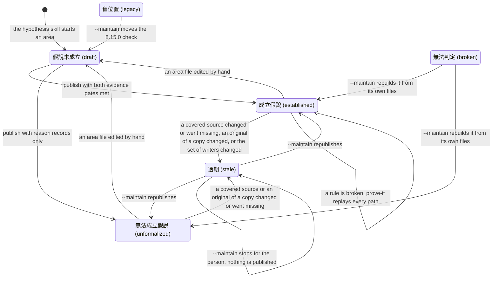

# hypothesis-states — the one picture of how a hypothesis moves

> Shared by every skill that reads or writes a hypothesis: `/hypothesis` (the only writer),
> and the readers `/review`, `/hunt`, `/prove-it`, `/health`, `/draft` and the green step of
> `tdd.md`. This file owns the transitions — what moves an area from one state to another and
> who makes the move. What each reader does in each state is `../hypothesis/references/reading.md`
> § State × reader; the state set and the order the script decides it in are in the same file
> § States. Cue for every user-facing line: use the plain names below.

The work follows an experiment: observation (`/hunt`, reading the source) → establishing the
hypothesis (`/hypothesis`) → proving it (`/prove-it`: 證實／推翻／無法到達). A hypothesis's own
states never claim proof; its success is 成立假說.

## Who moves each state

| From → to | Trigger | Who acts | Owner of the rule |
|---|---|---|---|
| — → 假說未成立 | a request, an H1–H8 row, a `/hunt` hand-off, a `/draft` sketch | `/hypothesis` | `../hypothesis/SKILL.md` §1 |
| 舊位置 → 假說未成立 | the first `--maintain` run offers the move | `/hypothesis --maintain` | `../hypothesis/references/maintain.md` § Migration |
| 假說未成立 → 成立假說 | publish, with every safety and liveness rule seen failing and every goal seen succeeding | `/hypothesis` | `hypothesis-status.py` `evidence_gaps` |
| 假說未成立 → 無法成立假說 | publish, with at least one complete reason record and no model | `/hypothesis` | `hypothesis-status.py` `evidence_gaps` |
| 成立假說 or 無法成立假說 → 過期 | a covered file's content changed or is gone, a `sources/` copy's original still exists and differs, or a watch pattern's matches changed; computed at read time | nobody writes it: the status script sees it | `hypothesis-status.py` `compute_state` |
| 過期 → 成立假說 / 無法成立假說 | `--maintain` sorts every change and republishes | a reader that sees 過期 calls `/hypothesis --maintain` at once; the main session makes the call, never a review agent | `../hypothesis/references/maintain.md` |
| 過期 stays 過期 | `--maintain` cannot sort a change without the person (a promise may have changed on purpose): nothing is published | `/hypothesis --maintain` stops and asks | `../hypothesis/references/maintain.md` § Publish or block |
| 成立假說 or 無法成立假說 → 假說未成立 | an area file differs from what the last publish hashed | nobody writes it: the status script sees it | `hypothesis-status.py` `compute_state` |
| 成立假說, a rule 被打破 | right after publish, for code that runs | `/hypothesis` hands the paths to `/prove-it`, which replays each on the real app | `../hypothesis/SKILL.md` §5 |
| any → 無法判定 | `hypothesis.json` unreadable or of an unknown schema | nobody writes it: the status script sees it | `hypothesis-status.py` `load_record` |
| 無法判定 → 成立假說 / 無法成立假說 | `--maintain` rebuilds the record from the area's own files and republishes; find the area with `--all`, since a broken record cannot say what it covers | `/hypothesis --maintain` | `../hypothesis/references/maintain.md` § Work list |

Readers never move a state themselves. They read it with `hypothesis-status.py`
(`../hypothesis/references/reading.md` § One command) and, for 過期, call the writer.
